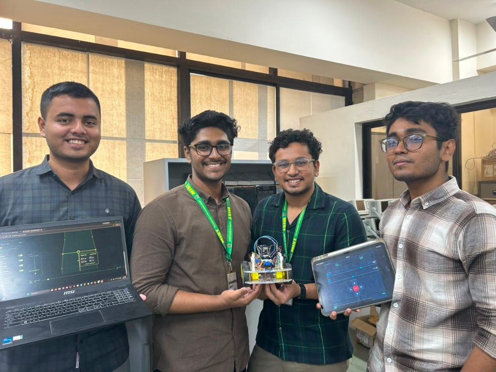

# 🚗 UGRV Surveillance Car & ESP32-CAM Firmware Suite

Complete embedded firmware codebase for the **Unmanned Ground Reconnaissance Vehicle (UGRV)** and its companion wireless **ESP32-CAM** surveillance node.

This firmware suite controls mobile locomotion, dual-side ultrasonic corridor mapping, LittleFS telemetry logging (`/sonar.csv`), fail-safe communications, live MJPEG video streaming, and seamless integration with the [EchoPath — Sonar Map Studio](https://akhlak007.github.io/ugrv_car/) web application.

---

<div align="center">
  
  <p><strong>UGRV Autonomous Reconnaissance Platform & Engineering Team</strong><br>
  <em>Live demonstration of the physical dual-sonar reconnaissance car, handheld mobile controller, and EchoPath spatial telemetry mapper.</em></p>
</div>

---

## 📁 Directory Structure

```text
code of car/
├── README.md                                  # Comprehensive hardware & firmware documentation
├── ZSP1774_UGRV_Car_for_Surveillance.ino      # Main ESP32 Car Controller Sketch (Root copy)
├── feed_sending_camera_code.ino               # ESP32-CAM Video Streamer Sketch (Root copy)
├── ZSP1774_UGRV_Car_for_Surveillance/         # Arduino IDE Sketch Directory
│   └── ZSP1774_UGRV_Car_for_Surveillance.ino  # Direct Arduino IDE compatible sketch
├── feed_sending_camera_code/                  # Arduino IDE Sketch Directory
│   └── feed_sending_camera_code.ino           # Direct Arduino IDE compatible sketch
└── docs/
    ├── group_photo.jpg                        # Team & hardware demonstration photo
    └── UGRV_Final_Project_Report.pdf          # Full engineering project report & documentation
```

> **Note for Arduino IDE users:** Arduino IDE requires a sketch `.ino` file to be inside a folder with the identical name. Both standalone sketch folders (`ZSP1774_UGRV_Car_for_Surveillance/` and `feed_sending_camera_code/`) are provided so you can double-click either sketch and immediately compile without moving files.

---

## ⚡ System Architecture

```
                        ┌──────────────────────────────────────────────────┐
                        │              OPERATOR DASHBOARD                  │
                        │    (Mobile / Laptop Browser or EchoPath Web)     │
                        └──────────────▲───────────────────▲───────────────┘
                                       │                   │
                        Control & Telemetry (HTTP)   Live MJPEG Video (:81)
                                       │                   │
                        ┌──────────────▼───────────────────┴───────────────┐
                        │             UGRV SoftAP Wi-Fi Hub                │
                        │            SSID: "UGRV CAR" (192.168.4.1)        │
                        └──────────────▲───────────────────▲───────────────┘
                                       │                   │
                     Internal HTTP Hub │                   │ Wi-Fi Client Link
                   Registration/Sync   │                   │
                                       │                   │
    ┌──────────────────────────────────┴─────┐   ┌─────────┴────────────────────────┐
    │       ESP32 MAIN CONTROLLER            │   │      ESP32-CAM (AI-THINKER)      │
    │  - Dual HC-SR04 Left/Right Sonar       │   │  - GC2145 / OV2640 Image Sensor  │
    │  - L298N Dual H-Bridge Motor Driver    │   │  - Port 81 MJPEG Live Video      │
    │  - Pan/Tilt Steering Micro-Servo       │   │  - PWM Flash Light Controller    │
    │  - LittleFS Telemetry Log (/sonar.csv) │   │  - Autonomous Hub Reconnect &    │
    │  - Embedded Web Server Dashboard       │   │    Fallback AP (192.168.10.1)    │
    └────────────────────────────────────────┘   └──────────────────────────────────┘
```

---

## 🛠️ Hardware Specifications & Pinouts

### 1. ESP32 Main Car Controller (`ZSP1774_UGRV_Car_for_Surveillance.ino`)

| Component | Pin Label | ESP32 GPIO | Description |
|---|---|---|---|
| **L298N Motor Driver** | `IN1` | `GPIO 14` | Left Motor Direction A |
| | `IN2` | `GPIO 18` | Left Motor Direction B |
| | `IN3` | `GPIO 19` | Right Motor Direction A |
| | `IN4` | `GPIO 25` | Right Motor Direction B |
| | `ENA` | `GPIO 32` | Left Motor PWM Speed (1 kHz, 8-bit) |
| | `ENB` | `GPIO 33` | Right Motor PWM Speed (1 kHz, 8-bit) |
| **Pan/Tilt Servo** | `SERVO_PIN` | `GPIO 13` | Steering / Camera Pan Servo (50 Hz, 16-bit) |
| **Left Sonar (HC-SR04)** | `L_TRIG` | `GPIO 12` | Left Ultrasonic Trigger pulse |
| | `L_ECHO` | `GPIO 34` | Left Ultrasonic Echo return (*Input Only*) |
| **Right Sonar (HC-SR04)**| `R_TRIG` | `GPIO 15` | Right Ultrasonic Trigger pulse |
| | `R_ECHO` | `GPIO 35` | Right Ultrasonic Echo return (*Input Only*) |

### 2. ESP32-CAM Camera Node (`feed_sending_camera_code.ino`)

| Function | Pin Definition | Value | Description |
|---|---|---|---|
| **Camera Sensor** | `PWDN_GPIO_NUM` | `32` | Power Down pin |
| | `RESET_GPIO_NUM` | `-1` | Software reset |
| | `XCLK_GPIO_NUM` | `0` | 10 MHz Master Clock |
| | `SIOD_GPIO_NUM` | `26` | SCCB Data (SDA) |
| | `SIOC_GPIO_NUM` | `27` | SCCB Clock (SCL) |
| | `Y9 - Y2` | `35, 34, 39, 36, 21, 19, 18, 5` | 8-bit Parallel Video Data Bus |
| | `VSYNC_GPIO_NUM` | `25` | Vertical Sync |
| | `HREF_GPIO_NUM` | `23` | Horizontal Reference |
| | `PCLK_GPIO_NUM` | `22` | Pixel Clock |
| **Illumination** | `FLASH_LED_PIN`| `GPIO 4` | Onboard high-brightness LED via PWM |

---

## 🌐 Network & Telemetry Endpoints

### ESP32 Car Access Point (`192.168.4.1`)
- **Default SSID**: `UGRV CAR`
- **Password**: `12345678`
- **Subnet**: `255.255.255.0`

#### HTTP API Endpoints:
- `GET /` : Embedded responsive dark-mode mission dashboard.
- `GET /drive?dir=[F|B|L|R|S]` : Motor movement commands (`F`orward, `B`ackward, `L`eft, `R`ight, `S`top).
  - *Safety:* Includes 800 ms auto-stop fail-safe if network packets drop.
- `GET /speed?val=[0-100]` : Sets motor PWM duty cycle percentage.
- `GET /servo?val=[0-180]` : Rotates servo mount angle (default center: 90°).
- `GET /state` : Returns live JSON state (speed, direction, left/right distance, camera IP, log size, memory).
- `GET /download` : Streams `/sonar.csv` for spatial reconstruction in EchoPath.
- `GET /clear` : Formats and resets the onboard LittleFS `/sonar.csv` file.
- `GET /sync?t=[epoch_ms]&tz=[offset_sec]` : Synchronizes ESP32 internal clock with client device.
- `POST /register` : Endpoint for companion camera auto-discovery.
- `GET /heartbeat?id=[ID]&ip=[IP]` : Keep-alive signal from camera node.

### ESP32-CAM Node
- **Camera Stream**: `http://192.168.4.X:81/stream` (Multipart MJPEG stream)
- **Snapshot Capture**: `http://192.168.4.X/snapshot` (Single JPEG frame)
- **Flash Brightness**: `http://192.168.4.X/flash?value=0..20` (Variable PWM brightness)
- **Device Info**: `http://192.168.4.X/device` (JSON device metadata)
- **Fallback Standalone AP**: SSID `UGRV-Camera` (`192.168.10.1`, pass: `12345678`)

---

## 📊 Telemetry Log Format (`/sonar.csv`)

The car logs dual ultrasonic returns every 20 seconds (or upon mission trigger) directly to LittleFS in standard CSV format:

```csv
Date,Time,Left Distance (cm),Right Distance (cm)
10-09-2026,06:51:13 PM,43.2,17.1
10-09-2026,06:51:33 PM,44.3,16.9
10-09-2026,06:51:53 PM,44.0,16.5
10-09-2026,06:52:13 PM,38.1,40.1
```

This telemetry log can be uploaded directly into the root [EchoPath — Sonar Map Studio](https://akhlak007.github.io/ugrv_car/) to generate interactive 2D corridor plans, boundary obstacles, and clearance analytics.

---

## 🚀 How to Compile & Flash

### 1. Arduino IDE Setup
1. Open **Arduino IDE** (version 2.x recommended).
2. Go to **File → Preferences** and ensure the ESP32 board manager URL is added:
   ```text
   https://espressif.github.io/arduino-esp32/package_esp32_index.json
   ```
3. Open **Tools → Board → Boards Manager**, search for `esp32` by Espressif Systems, and ensure it is updated (Core 3.x supported).

### 2. Flashing the Car Controller (`ZSP1774_UGRV_Car_for_Surveillance.ino`)
1. Open `ZSP1774_UGRV_Car_for_Surveillance/ZSP1774_UGRV_Car_for_Surveillance.ino`.
2. Select:
   - **Board**: `ESP32 Dev Module` (or `NodeMCU-32S`)
   - **Partition Scheme**: `Huge APP (3MB No OTA/1MB SPIFFS)` or `Minimal SPIFFS (Large APPS with OTA)`
   - **Upload Speed**: `921600` (or `115200`)
3. Connect your ESP32 board via USB, select the COM port, and click **Upload**.

### 3. Flashing the ESP32-CAM Node (`feed_sending_camera_code.ino`)
1. Open `feed_sending_camera_code/feed_sending_camera_code.ino`.
2. Select:
   - **Board**: `AI Thinker ESP32-CAM`
   - **CPU Frequency**: `240MHz (WiFi/BT)`
   - **Flash Frequency**: `80MHz`
   - **Partition Scheme**: `Huge APP (3MB No OTA/1MB SPIFFS)`
   - **PSRAM**: `Enabled`
3. Connect via FTDI programmer (Bridge `GPIO 0` to `GND` during upload, disconnect and hit Reset to run).
